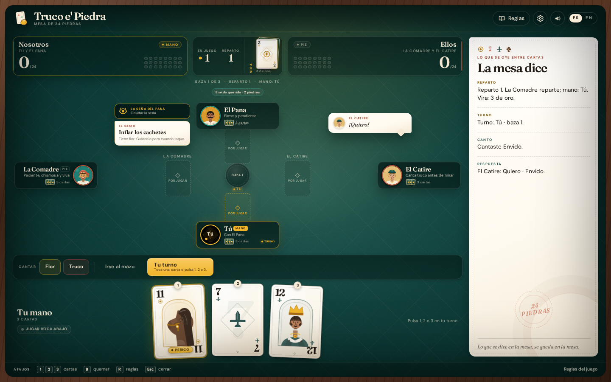

<p align="center">
  
</p>

<h1 align="center">Truco e' Piedra</h1>

<p align="center">
  <strong>24 piedras, four friends, one Caracas kitchen table.</strong><br>
  A single-player 2v2 Venezuelan truco game that runs in the browser.
</p>

<p align="center">
  <a href="https://gerrcass.github.io/venezuelan-truco-game/"><strong>▶ Jugar la mesa · Play the table</strong></a>
  &nbsp;·&nbsp;
  <a href="docs/rules/TRUCO-VENEZOLANO.md">Rules</a>
  &nbsp;·&nbsp;
  <a href="docs/adr/">Decisions</a>
</p>

<p align="center">
  <a href="https://github.com/gerrcass/venezuelan-truco-game/actions/workflows/ci.yml"></a>
  <a href="https://github.com/gerrcass/venezuelan-truco-game/actions/workflows/pages.yml"></a>
  <a href="LICENSE"></a>
</p>

<p align="center">
  <a href="https://gerrcass.github.io/venezuelan-truco-game/">
    
  </a>
  <br>
  <sub>A real deal (seed <code>seed-17</code>): vira 3 de oro, the perico in hand, El Pana's seña and an envido on the table.</sub>
</p>

## What it is

**Truco e' Piedra** is a free, single-player 2v2 Venezuelan truco game played to **24 piedras**. You sit with **El Pana** against **La Comadre** and **El Catire** at a warm Caracas kitchen table. The rules are the Venezuelan ones, not the Argentine ones: the **vira** turns a court card into the **perico** or **perica**, **flor** cancels **envido**, and the **prive** shows up when somebody is one piedra away from winning.

No backend, no accounts, no analytics. It is a static site, a deck of cards and a very opinionated partner.

## What's on the table

- **Vira, perico and perica** — the vira's palo promotes the caballo and sota (or the rey, when the vira is a court card). The table labels every piece, and El Pana's seña points at one.
- **Envido and la falta** — the full four-step ladder: envido, quiero y envido, quiero y 5 piedras más and envido la falta.
- **Flor and flor reservada** — three of a palo, or a piece with two of a palo. Flor cancels envido. Reservada (perico + perica) is automatic and worth 5.
- **The truco ladder** — truco, retruco, vale nueve and vale juego, with accepts, declines, raises and folds.
- **Prive, quemar and pardas** — the 23-piedra prive, face-down burns and the house parda rules, all itemized.
- **Señas and table talk** — El Pana sends one gesture per reparto; the three personas have their own risk appetite and their own mouth.
- **Spanish and English** — every visible string, rule and taunt exists in both languages. Spanish is the default.
- **Keyboard and phone first** — play with 1–3, open rules with R, burn with B, close with Escape. The table works at 360 px and respects `prefers-reduced-motion`.
- **A deterministic engine** — seeded shuffles and bot decisions. The same seed gives the same mesa, which is how the screenshot above was taken.

## How to play in 30 seconds

1. You and El Pana get **three cards** each. The team that wins **two of the three bazas** takes the reparto.
2. Before your first card you may call **envido** (a bet on your best two-card tanto) or **flor** (three of a palo, or a piece with two of a palo).
3. You may call **truco** on your turn, in any baza. The other team can accept, decline or raise.
4. The first team to **24 piedras** wins the partida. There is no win-by-two; the mesa does not wait.

If a canto confuses you, open **Reglas** — the school has a tab for each lance, with cards and formulas.

## Stack and architecture

- **Vite + React + TypeScript** single-page app, no router and no backend. Relative asset paths keep the GitHub Pages build portable.
- **Pure engine** in `src/engine/`: cards, scoring, reducer, legal actions and seat-scoped views. No React, no DOM and no ambient randomness.
- **One information boundary** — `viewFor(state, seat)` is the only thing a seat sees. The bots consume that view and a seeded RNG; they never read another hand.
- **Three AI personas** with different thresholds and taunt banks: steady El Pana, patient La Comadre and reckless El Catire.
- **Tests** — Vitest and Testing Library for the engine, reducer, AI, components and copy; Playwright for the production journey.
- **Delivery** — GitHub Actions runs typecheck, lint, unit tests, build and E2E; Pages deploys `main`.

The decisions behind the big seams live in [`docs/adr/`](docs/adr/), and the rules authority is [`docs/rules/TRUCO-VENEZOLANO.md`](docs/rules/TRUCO-VENEZOLANO.md).

## Development

Requires **Node 22** (see `.nvmrc`).

```bash
npm install
npm run dev       # local table at http://localhost:5173
npm run check     # typecheck + lint + unit tests + production build
npm run e2e       # Playwright against the production build
npm run build     # production bundle in dist/
npm run preview   # serve the production build
npm run format    # Prettier
```

Playwright needs Chromium once:

```bash
npx playwright install chromium
```

`npm run e2e` builds the app, serves it on `127.0.0.1:4173` and runs the journey in `e2e/`. If another local project owns 4173, use `E2E_PORT=4174 npm run e2e`.

## Rules and sources

The full ruleset, scoring order and house rulings are in [`docs/rules/TRUCO-VENEZOLANO.md`](docs/rules/TRUCO-VENEZOLANO.md). The short version of the house calls:

- **Flor reservada is 5**, not 3.
- **Flor settles when the first baza closes**, so both teams get the whole first baza to declare.
- **Prive is called by the team at 23** and replaces envido for that reparto.
- **No flor-envido betting subgame**: when both teams have flor, the best flor is compared automatically.

Sources used to build the ruleset:

| Source                                                                                              | What it gave us                                       |
| --------------------------------------------------------------------------------------------------- | ----------------------------------------------------- |
| [Wikipedia — _Truco venezolano_](https://es.wikipedia.org/wiki/Truco_venezolano)                    | The deck, the vira, the flor and the 24-piedra target |
| [Ludoteka — _Reglas del Truco Venezolano_](https://www.ludoteka.com/juegos/truco-venezolano/reglas) | The envido ladder and the truco values                |
| [El Truco Venezolano — _Vocabulario_](https://eltrucovenezolano.com/vocabulario/)                   | The mesa's vocabulary: perico, perica, matas, señas   |

## Deployment

`main` is deployed to GitHub Pages by [`.github/workflows/pages.yml`](.github/workflows/pages.yml). CI runs the same checks plus the Playwright journey on every pull request and on `main`.

Live: **<https://gerrcass.github.io/venezuelan-truco-game/>**

## License

MIT. The code and the original SVG deck, avatars and art are part of this repository. Card games are not copyrightable; this deck is original work.
